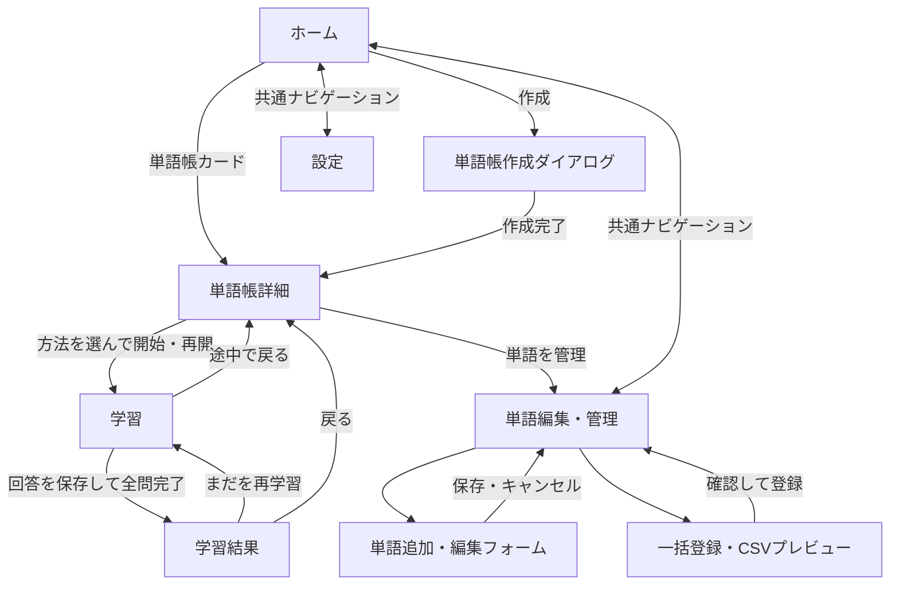

# 単語帳Webアプリ — Phase 1 設計案

作成日：2026-09-17。確認待ちの設計案です。型定義と保存例は設計を説明するためのもので、アプリの実装コードはまだ作成していません。

React / Vite / TypeScript / Tailwind CSS / lucide-react を使用する前提です。Phase 2以降はユーザーの確認後に、指定された順番で進めます。以下の寸法・操作・保存形式は、このアプリ向けの設計提案です。

## 1. アプリ全体の画面構成

| 画面 | 表示内容 | 主な操作 |
| --- | --- | --- |
| ホーム | 単語帳カード、全単語数、覚えた数、まだの数、未学習数、進捗バー | 単語帳の作成・名前変更・削除、詳細を開く |
| 単語帳詳細 | 単語帳名、学習状況、出題方法、前回の続き | 学習開始・再開、「まだ」を復習、単語管理へ移動 |
| 学習 | 問題／答えカード、任意の補足、問題番号、回答ボタン | 答えを表示、まだ／覚えた、途中で戻る |
| 単語編集・管理 | 単語帳選択、単語一覧、検索、状態フィルター、追加・編集フォーム | 追加・編集・削除、一括登録、CSV入出力 |
| 設定 | 標準の出題方法、スワイプ操作の有効／無効、保存先の説明 | 設定の変更・保存 |

単語帳作成・名前変更・削除確認はダイアログとして開きます。単語フォーム、一括登録プレビュー、CSVプレビューは管理画面内の補助画面とし、学習結果は学習画面の完了状態として表示します。

ホームはサンプルデータを自動登録せず、0冊なら「最初の単語帳を作成」を表示します。新規作成後はその単語帳の詳細へ進み、0語なら「単語を追加」を案内します。

**件数と進捗の定義**

- `unlearned`＝未学習。通常の新規登録時の状態。
- `learning`＝学習時に「まだ」と回答した状態。
- `remembered`＝学習時に「覚えた」と回答した状態。
- 「まだ」には未学習を含めません。ホームにも未学習数を添えます。
- 進捗は `Math.floor(覚えた数 / 全単語数 * 100)`。全単語数が0なら0％です。

例：10語のうち「覚えた」6語、「まだ」3語、「未学習」1語なら、進捗60％です。これは習得状況であり、今回の学習で何問回答したかとは別の指標です。

## 2. 画面遷移



初期構成ではハッシュ形式のURLを使い、URLの解釈とブラウザの戻る・進む処理を `useNavigation` に集約します。ルーティング専用ライブラリは初期の必須依存に追加しません。

| URL案 | 対応画面 |
| --- | --- |
| `#/` | ホーム |
| `#/decks/:deckId` | 単語帳詳細 |
| `#/decks/:deckId/study` | 学習・学習結果 |
| `#/manage` | 管理対象の単語帳を選択 |
| `#/decks/:deckId/words` | 選択した単語帳の管理 |
| `#/decks/:deckId/words/new` | 単語追加 |
| `#/decks/:deckId/words/:wordId/edit` | 単語編集 |
| `#/settings` | 設定 |

存在しない単語帳・単語へのアクセスは「見つかりません」と戻り先を表示します。フォームに未保存の変更がある状態で別画面へ移る場合は、変更を破棄するか確認します。

スマートフォンの共通下部ナビゲーションは「ホーム／単語管理／設定」です。学習中はその領域を回答操作に使い、上部に「戻る」を配置します。通常画面のナビと回答ボタンを重ねません。

## 3. TypeScriptのデータ型

以下は型の設計案です。日時は保存しやすいUTCのISO 8601文字列を使い、表示時に利用者の環境に合わせて整形します。`ISODateString`という名前だけでは日時の正しさを保証できないため、読み込み時に値も検証します。

```ts
type EntityId = string;
type ISODateString = string;

type LearningStatus = "unlearned" | "remembered" | "learning";
type StudyMode = "all" | "unlearned" | "learning" | "random";
type StudyRating = Exclude<LearningStatus, "unlearned">;

interface Deck {
  id: EntityId;
  name: string;
  createdAt: ISODateString;
  updatedAt: ISODateString;
}

interface Word {
  id: EntityId;
  deckId: EntityId; // 所属先のID。単語帳の名前を変えても関係が保たれる。
  question: string;
  answer: string;
  note: string; // 補足なしは空文字に統一する。
  status: LearningStatus;
  lastStudiedAt: ISODateString | null;
  createdAt: ISODateString;
  updatedAt: ISODateString;
}

// フォームからIDや学習日時を変更できないよう、入力項目を分ける。
type WordInput = Pick<Word, "question" | "answer" | "note">;

interface AppSettings {
  defaultStudyMode: StudyMode;
  swipeEnabled: boolean;
}

interface StudyAnswer {
  wordId: EntityId;
  rating: StudyRating;
  answeredAt: ISODateString;
}

interface StudySession {
  id: EntityId;
  deckId: EntityId;
  mode: StudyMode;
  wordIds: EntityId[]; // 開始時に出題順を固定する。再開時に並べ替えない。
  answers: StudyAnswer[]; // この回の回答のみ。長期的な学習履歴ではない。
  startedAt: ISODateString;
  updatedAt: ISODateString;
}

interface AppData {
  version: 1; // データ形式の番号。形式を変更するときに移行処理を追加する。
  revision: number; // 保存のたびに増やす。同じ形式のデータ更新を識別する。
  decks: Deck[];
  words: Word[];
  settings: AppSettings;
  activeSession: StudySession | null; // 保存する学習セッションは全体で1つ。
}

// 表示時に計算する値。AppDataへ重複保存しない。
interface DeckProgress {
  total: number;
  unlearned: number;
  learning: number;
  remembered: number;
  percent: number;
}

type DataErrorCode =
  | "unavailable"
  | "corrupted"
  | "unsupported-version"
  | "quota-exceeded"
  | "conflict"
  | "write-failed";

type Result<T> =
  | { ok: true; value: T }
  | { ok: false; error: { code: DataErrorCode; message: string } };

// 呼び出し側は保存先を意識しない。非同期の保存先にも備える。
interface AppRepository {
  load(): Promise<Result<AppData | null>>; // nullは初回で保存データなし。
  save(data: AppData, expectedRevision: number): Promise<Result<AppData>>;
}
```

IDは名前・配列番号に依存しない一意な文字列にします。`Deck.updatedAt`は単語帳名などの変更、`Word.updatedAt`は内容や学習状態の変更で更新します。回答時には `lastStudiedAt` も更新します。新規単語は `unlearned`、`lastStudiedAt: null` です。CSVで状態だけが与えられた場合、学習日時を推測せず `null` とします。

`StudySession.answers.length`を次の出題位置に使い、別のカーソルを重複保存しません。回答IDは常に `wordIds` の先頭から同じ順番で並ぶことを検証します。例えば出題順がA・B・Cで回答数が1なら、次はBです。回答数が総数と同じなら結果表示です。

## 4. LocalStorageのデータ構造

保存キーは **`kotoba:app`** の1つにまとめ、値は `AppData` をJSON文字列にしたものとします。形式のバージョンはキー名でなく中身に持たせます。

初期データの例：

```json
{
  "version": 1,
  "revision": 0,
  "decks": [],
  "words": [],
  "settings": {
    "defaultStudyMode": "all",
    "swipeEnabled": true
  },
  "activeSession": null
}
```

単語帳 `deck-001` に単語 `word-001` を登録する場合、`decks` にその単語帳、`words` に `deckId: "deck-001"` の単語を入れます。単語帳の中へ単語配列を埋め込まないため、単語を個別に扱いやすく、将来のDBでの対応関係も明確になります。

学習進捗は、保存済みの `words[].status` から毎回再計算して復元します。例えば「覚えた数」も別に保存すると、単語削除時に件数だけ更新し忘れる可能性があるためです。算出できる値を重複して状態に持たせない方針は、[React公式の状態設計](https://react.dev/learn/choosing-the-state-structure)でも説明されています。

**読み込みと保存の流れ**

1. `localStorageRepository` が `getItem` とJSON解析を例外処理付きで実行します。
2. 外部データをまず `unknown` として扱い、version、必須項目、状態値、日時、IDの重複、所属先、セッションの整合性を検証します。
3. キーが存在しない場合だけ初期データを用意します。破損・アクセス不可・未知のversionを「初回」と扱いません。
4. 破損や未知のversionでは元の文字列を上書きせず、通常の保存を止めて復旧案内を表示します。読み取れた元データはファイルとして退避できる設計にします。初期化する場合は利用者の明示操作と削除確認を必要とします。
5. 単語の保存・回答・削除・設定変更ごとに、次のデータを作って検証し、`revision`を増やして保存します。
6. 保存成功後に共有状態と画面を更新します。回答状態とセッションの回答位置も同じJSONに入れて1回で保存します。ブラウザを閉じる瞬間の保存だけに依存しません。
7. 保存が失敗したら「保存できませんでした」と再試行を表示します。フォーム入力や表示中の問題を保持し、「保存済み」とは表示しません。

`localStorage`は文字列を保存し、通常はブラウザを閉じても保持します。一方でオリジン（プロトコル・ホスト・ポート）ごとに保存先が分かれます。このアプリのPCとスマートフォン間の自動同期は対象外です。開発サーバーのポートを変えた場合も保存先が変わる点に注意します。[MDN：localStorage](https://developer.mozilla.org/en-US/docs/Web/API/Window/localStorage)

保存が禁止されている環境や容量不足による例外も扱います。保存できることを無条件に保証せず、エラーを画面に示します。[MDN：Web Storageの利用可否](https://developer.mozilla.org/en-US/docs/Web/API/Web_Storage_API/Using_the_Web_Storage_API)

複数タブでは `storage` イベントと保存前の `revision` の照合で変更を検知し、古い状態のまま更新しないよう再読み込みを案内します。未保存入力はその場に残します。ただしLocalStorage版で厳密な同時編集は保証せず、編集は1タブを基本とします。イベントは同じ保存領域を使う別の文書へ通知されます。[MDN：storage変更の通知](https://developer.mozilla.org/en-US/docs/Web/API/Web_Storage_API/Using_the_Web_Storage_API#responding_to_storage_changes_with_the_storageevent)

## 5. コンポーネント構成と責務

```text
App
└─ AppProvider                  共有状態、保存処理の呼び出し
   └─ AppLayout                 共通レイアウト
      ├─ MobileNavigation      スマートフォンの下部ナビ
      ├─ Sidebar               PCのサイドバー
      └─ 各Page
         ├─ HomePage           DeckCard / DeckFormDialog
         ├─ DeckDetailPage     ProgressSummary / StudyModeSelector
         ├─ StudyPage          FlashCard / StudyActions / StudyResult
         ├─ WordManagerPage    WordFilters / WordList / WordTable
         │                    WordForm / BulkImportPanel / ImportPreview
         └─ SettingsPage       設定フォーム
```

| 層 | 役割 | この層に置かない処理 |
| --- | --- | --- |
| `pages` / `components` | 画面、入力、フォーカス、操作結果の表示 | LocalStorageへの直接アクセス、CSV解析、出題順決定 |
| `hooks` / `providers` | データ操作の窓口、フォームや学習の一時状態、画面遷移 | ブラウザ固有の保存処理 |
| `services` | 保存先の実装、データ検証・移行、出題・CSV処理 | JSXや表示レイアウト |
| `utils` | 進捗計算、検索、日時整形などの小さな共通関数 | 画面状態や永続化の管理 |
| `types` | データと処理の入出力を定義 | 処理の実装 |

例：「覚えた」を押す → `useStudySession`が次のデータを作成 → `useAppData`経由でrepositoryへ保存 → 成功したら次の問題へ進む、という分担です。

`studyService` は単語一覧と学習方法から単語IDの順番を返す関数として独立させます。`csvService`は文字列やバイト列と検証結果を扱い、プレビューの描画はコンポーネントに任せます。共通の `ConfirmDialog`、`ErrorNotice`、`EmptyState`、`StatusBadge` で表示と操作を統一します。

## 6. ディレクトリ構成

以下は完成時の予定構成です。Phase 1で実際に作成したのは `docs/phase-1-design.md` のみです。各実装ファイルは必要になるPhaseで追加します。

```text
単語帳アプリ/
├─ docs/
│  └─ phase-1-design.md
├─ src/
│  ├─ components/
│  │  ├─ layout/       AppLayout, MobileNavigation, Sidebar
│  │  ├─ deck/         DeckCard, DeckFormDialog, ProgressSummary
│  │  ├─ study/        FlashCard, StudyActions, StudyModeSelector, StudyResult
│  │  ├─ editor/       WordForm, WordList, WordTable, WordFilters,
│  │  │                BulkImportPanel, ImportPreview
│  │  └─ common/       ConfirmDialog, ErrorNotice, EmptyState, StatusBadge
│  ├─ pages/
│  │  ├─ HomePage.tsx
│  │  ├─ DeckDetailPage.tsx
│  │  ├─ StudyPage.tsx
│  │  ├─ WordManagerPage.tsx
│  │  └─ SettingsPage.tsx
│  ├─ hooks/
│  │  ├─ useAppData.ts
│  │  ├─ useNavigation.ts
│  │  ├─ useStudySession.ts
│  │  ├─ useSwipe.ts
│  │  └─ useWordEditor.ts
│  ├─ providers/
│  │  └─ AppProvider.tsx
│  ├─ services/
│  │  ├─ appRepository.ts
│  │  ├─ memoryRepository.ts
│  │  ├─ localStorageRepository.ts
│  │  ├─ dataValidation.ts
│  │  ├─ dataMigrations.ts
│  │  ├─ studyService.ts
│  │  └─ csvService.ts
│  ├─ types/
│  │  ├─ domain.ts
│  │  ├─ storage.ts
│  │  └─ import.ts
│  ├─ utils/
│  │  ├─ progress.ts
│  │  ├─ wordSearch.ts
│  │  ├─ bulkParse.ts
│  │  └─ dateFormat.ts
│  ├─ App.tsx
│  ├─ main.tsx
│  └─ index.css
├─ index.html
├─ package.json
├─ tsconfig.json
└─ vite.config.ts
```

提示された構成に `providers` と `components/deck` を追加しました。前者は全画面で共有するデータの置き場所、後者は単語帳カードなどの専用部品をまとめるためです。学習状態はProviderで共有し、検索語・入力途中の内容・カードの表裏などは必要な画面の中に置きます。

Phase 2・3では `memoryRepository` を使用し、画面と単語操作を先に確認します。この段階では更新するとデータが消えることを明示します。Phase 4で同じ契約の `localStorageRepository` に切り替えます。必要のない将来version向け移行処理は作らず、移行関数の置き場所だけ決めておきます。

## 7. スマートフォンとPCでのUIの違い

| 項目 | スマートフォン：320px〜 | タブレット：768px〜 | PC：1024px〜 |
| --- | --- | --- | --- |
| ナビゲーション | 下部、文字とアイコンを併用 | 下部を基本 | 左サイドバー |
| 単語帳一覧 | 基本1列 | 余白に応じて2列 | 余白に応じて複数列 |
| 単語管理 | 縦に並ぶ単語カード＋フォーム | フォームを中心に幅を活用 | テーブル＋行内編集 |
| 単語追加 | 問題・答え・補足の縦フォーム | 同左 | 連続入力行、一括登録 |
| 学習 | 大きなカード、下部の回答操作 | カード幅を制限して中央配置 | 中央カード、ボタン＋キーボード |
| 入力操作 | 大きな保存・キャンセル、編集時は削除 | 同左 | Tab、Shift+Tab、Enter |

幅は固定端末の判定に使わず、コンテンツに応じたCSSレイアウトの切り替え目安とします。320pxで横スクロールが出ないこと、長い英単語や補足でも折り返すことを確認します。

スマートフォンの学習画面案：

```text
┌─────────────────────────┐
│ ‹ 戻る          12 / 50 │
│ ──────── 学習の進み具合 │
│                         │
│           RFP           │
│                         │
│    タップして答えを見る │
│                         │
│ 答え表示後：補足を開く  │
│                         │
│ [ ← まだ ] [ 覚えた ✓ ] │
└─────────────────────────┘
```

回答ボタンは高さ56px以上、その他の主要タップ領域は44px以上を設計目標とします。端末下端の余白と本文の下余白を確保し、操作バーが内容や入力欄を隠さないようにします。これは本アプリの設計値で、実機確認後に調整します。

PCの表は「問題／答え／補足／状態／操作」。Enterで保存して次の行の問題欄へ移動し、新規追加行では次の空の問題欄へ戻します。編集中の複数行欄はShift+Enterで改行、日本語変換中のEnterは保存しません。TabとShift+Tabは通常のフォーカス移動を保ちます。保存に失敗した場合は移動しません。

カードはキーボードでも答えを表示できるようにし、補足を開く操作を別ボタンに分けます。「まだ」「覚えた」は色に加えて文字とlucideのアイコンで示します。フォーカス表示、入力ラベル、エラー通知、確認ダイアログのフォーカス制御を備え、動きを減らす設定にも配慮します。

## 8. 実装上注意すべき点

**出題方法と再開**

| 方法 | 対象と順番 |
| --- | --- |
| すべて | 全単語、作成日時順。日時が同じ場合はID順で安定させる |
| 未学習のみ | `unlearned`のみ、同じ基準の順番 |
| 「まだ」のみ | `learning`のみ、同じ基準の順番 |
| ランダム | 全単語を開始時に一度シャッフル、各単語を1回ずつ出題 |

学習開始時の対象と順番をセッションへ保存します。回答するたびに絞り込み直すと「まだ」から「覚えた」になった単語が消えて位置がずれるため、途中で再構築しません。「まだ」を同じ回の末尾に自動追加せず、完了後に「まだをもう一度」を表示します。直前のセッションが残っており、候補が2語以上あって新しい回の先頭が最後に回答した語と同じ場合は、先頭と2番目を交換します。この場合だけ表の基本順序より連続出題の回避を優先します。候補が1語なら繰り返しになることを明示します。前セッションを閉じた後は表の順序に従います。

途中で戻ったりブラウザを閉じたりしても、保存済みの回答位置から再開します。再開時は問題面から表示します。別の学習を始める際に未完了セッションがあれば、続けるか新しい回へ切り替えるか選択します。切り替えても単語の学習状態は残ります。終了結果は次の開始または結果を閉じるまで保持します。

単語帳を削除する際は所属単語と対象セッションをまとめて削除します。出題対象の単語を内容編集・削除した場合はそのセッションを終了し、保存済みの単語状態を残して再開始を案内します。途中で追加した単語は次の回から対象にします。

**スワイプ・連打・誤操作**

答えを表示した後だけ判定できるようにし、左を「まだ」、右を「覚えた」にします。カード領域内で始まった横方向の一定距離以上の移動だけを受け付け、縦スクロール、小さな指の揺れ、補足内の操作、画面端から始まる操作は除外します。暫定の判定値は横移動80px以上かつ横移動が縦移動の1.5倍以上とし、実機で調整します。

スワイプは指を離した時点で確定し、キャンセルされた操作は破棄します。スワイプ後のクリックで次のカードを裏返さないようにします。保存中とカード切り替え中は二重受付を防ぎ、次のカードは必ず問題面に戻します。ボタンは常に表示し、答え表示前は無効と理由を示します。

**入力と検索**

単語帳名・問題・答えは前後の空白を除いた値が必須、補足は任意です。文字数上限などは実装時に定数として一か所で管理します。入力エラーは該当欄の近くに表示し、入力内容を保持します。削除ダイアログには対象名を表示し、単語帳削除なら所属単語数も示します。

検索は選択中の単語帳に対し、問題・答え・補足のいずれかに一致する部分文字列を探します。検索用の値だけ大文字小文字や全角半角を正規化し、保存値は書き換えません。状態フィルターとはAND条件で組み合わせます。検索結果0件と単語自体が0件の案内を分けます。

**一括登録とCSV**

貼り付けの一括登録は `問題 | 答え | 補足` を1行1語として扱います。2列なら補足なし、3列なら補足あり、空行は無視します。必須欄が空または列数が不正なら行番号付きのエラーを表示します。値の中に `|` や改行が必要な場合はCSVを案内します。

CSVは選択した1つの単語帳単位で入出力します。最小のヘッダーは `question,answer`、任意列は `note,status,lastStudiedAt,createdAt,updatedAt` とし、エクスポートではすべての列を出します。日本語の内容は利用可能で、ヘッダーはこの英語名に統一しテンプレートを提供します。単語帳名は画面とファイル名で識別します。

インポートでは新しいIDを割り当てて選択中の単語帳へ追加します。既存単語の自動上書きはしません。日時が省略された場合、作成・更新日時は登録時刻、最終学習日時は `null`。状態省略時は `unlearned` です。最終学習日時の `null` はCSVでは空欄として出力し、読み込み時に `null` に戻します。その他の任意列の空欄も省略と同じ扱いにします。空欄以外で指定された状態値や日時が不正ならエラーにします。

既存データ・取り込み内で問題と答えが同じ行は重複候補として知らせ、初期状態では除外します。追加するかをプレビューで選べるようにします。必須項目や形式が不正な行がある場合は登録できず、修正後に再プレビューします。確認後に選ばれた全件を一度に保存し、途中の行だけ登録された状態を避けます。

CSV内のカンマ・改行・ダブルクォートは引用規則に従って処理し、単純な `split(",")` では解析しません。[RFC 4180：CSVの形式](https://www.rfc-editor.org/rfc/rfc4180)

エクスポートはUTF-8 BOM付き、インポートはUTF-8を標準としてBOMの有無に対応する設計です。Shift_JISは明示的な文字コード選択で対応し、自動判定だけに頼りません。日本語のプレビューを確認してから登録します。文字列への復号には `TextDecoder` を使う方針です。[MDN：TextDecoder](https://developer.mozilla.org/en-US/docs/Web/API/TextDecoder)

**保存先の差し替えと将来機能**

UIは `useAppData` を通じて操作し、LocalStorageのキーやJSON形式を知る必要がない構成にします。将来クラウドへ移すときは保存サービスを中心に変更できます。ただし認証、通信切断時の扱い、端末間の競合解決まで自動で実現できるわけではありません。全データをまとめて保存する現在の契約も、データ量に合わせて見直す可能性があります。

Supabase、アカウント、同期、間隔反復、長期の学習履歴・グラフ、ダークモード、PWA、オフライン起動、AI生成は今回実装しません。これらのためのダミー画面や未使用フィールドも追加しません。

## Phase 1の確認内容と次の段階

| 項目 | 今回の結果 |
| --- | --- |
| 実施内容 | 画面、遷移、型、保存構造、コンポーネント、ディレクトリ、端末別UI、例外対応の設計 |
| 作成ファイル | `docs/phase-1-design.md` |
| アプリ実装 | 未着手。プロジェクト生成、依存関係追加、Phase 2以降のコード作成なし |
| 確認方法 | 以下の利用例で、画面遷移とデータ更新に矛盾がないか設計を確認 |
| 動作テスト | 実行できるアプリがまだないため未実施 |
| 次のPhase | Vite等の初期構成、型の実ファイル化、ホーム画面と単語帳の作成・名前変更・削除、メモリ上での確認 |

設計確認用の利用例：

1. 初回0冊 → 「基本情報技術者」を作成 → 0語の詳細 → 単語追加へ進める。
2. RFPを未学習で追加 → 学習で答えを表示 → 「まだ」 → 保存後に次の問題へ進む。
3. 学習を中断 → 再読み込み → 未回答位置から再開でき、ホームの「まだ」数も一致する。
4. 保存を失敗させた想定 → 「覚えた」を押しても次へ進まず、再試行できる。
5. 不正なCSV・破損JSONを読み込んだ想定 → エラーを表示し、既存の単語帳を上書きしない。
6. PCで日本語変換を確定 → それだけでは行を保存しない。通常のEnter保存成功後は次の入力欄へ進む。

各Phase終了時には「実装内容／作成・変更ファイル／動作確認方法と結果／次のPhase」を報告し、ユーザーの確認を待ちます。

企業での利用例としては、社内用語や製品知識の研修への応用が考えられます（推測。特定企業の導入実績を示すものではありません）。

企業ではこのように利用しています
